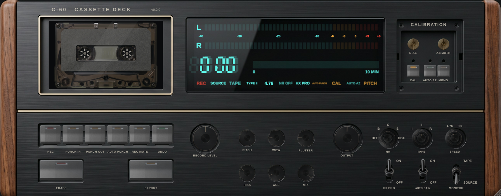

# C-60 — Cassette Deck

Plugin audio (AU + VST3, macOS universal) da mettere sul **master bus**: il mix viene registrato su una
cassetta virtuale da 10 minuti, agganciata alla timeline del DAW. Puoi ri-registrare solo alcune parti
della canzone e costruire un **collage** di passate diverse, come su una piastra vera, con tutti i segni
del caso: saturazione magnetica, compressione degli acuti, wow & flutter, fruscio, dropout, buchi della
testina di cancellazione ai punti di punch.



L'interfaccia è un *best of* modulare delle piastre più celebri: vano cassetta stile Nakamichi RX-505,
display fluorescente stile Pioneer / Sony ES, sportello di calibrazione stile Nakamichi 1000ZXL / Revox
B215, tasti piatti stile Revox, fianchi in noce stile Sony ES.

---

## Installazione

Funziona su Mac con chip Apple (M1/M2/M3/M4) e Intel, macOS 11 o successivo.
In Logic lo trovi in **Audio Units → MyPlugins → C-60**: va sul canale **Stereo Out** (il master).

### Metodo A — con l'installer già pronto (offline, consigliato)

Non serve internet né alcuno strumento di sviluppo. Il plugin compilato e validato
(auval + pluginval strictness 10) è nella repo: [`release/C-60-macOS.zip`](release/C-60-macOS.zip).

1. Copia `release/C-60-macOS.zip` sul Mac (anche da una chiavetta o un SSD).
2. Doppio clic sullo zip: compare la cartella `C-60`. Trascinala sulla Scrivania.
3. Chiudi Logic Pro se è aperto.
4. **Tasto destro** su `Installa C-60.command` → **Apri** → **Apri**.
   Si apre il Terminale e alla fine scrive «C-60 installato.».
   - Se macOS non mostra «Apri»: Impostazioni di Sistema → Privacy e sicurezza → in fondo
     «Apri comunque», poi ripeti.
5. Apri Logic, aspetta la scansione dei plugin, inserisci C-60 sullo Stereo Out.
6. Premi **CAL** nello sportello CALIBRATION.

Lo script copia `C-60.component` (AU) in `~/Library/Audio/Plug-Ins/Components` e `C-60.vst3` in
`~/Library/Audio/Plug-Ins/VST3`, toglie la quarantena, firma localmente (ad-hoc) e fa rileggere i
plugin al sistema.

### Metodo B — compilando dal codice (serve internet)

1. Strumenti, una volta sola:
   ```bash
   xcode-select --install          # compilatore Apple
   brew install cmake              # oppure scarica CMake da cmake.org
   ```
2. Scarica la repo e compila (5–10 minuti; JUCE viene scaricato in automatico):
   ```bash
   git clone https://github.com/lberna777/plugin-creator.git
   cd plugin-creator/Plugin-Creator/C60
   cmake -S . -B build -DCMAKE_BUILD_TYPE=Release
   cmake --build build --config Release --target C60_AU C60_VST3 -j 8
   ```
3. Installa con lo stesso script del metodo A:
   ```bash
   mkdir -p ~/Desktop/C-60
   cp -R build/C60_artefacts/Release/AU/C-60.component build/C60_artefacts/Release/VST3/C-60.vst3 ~/Desktop/C-60/
   cp "dist/Installa C-60.command" dist/LEGGIMI.txt ~/Desktop/C-60/
   bash ~/Desktop/C-60/"Installa C-60.command"
   ```
4. (Facoltativo) verifica come fa Logic: `auval -v aufx Cs60 Mypl` deve finire con «AU VALIDATION SUCCEEDED».

### Se Logic non lo vede

- Logic Pro → Impostazioni → **Gestione plug-in**: cerca «C-60», spunta «Usa» o premi
  «Reimposta e riesegui scansione».
- Riavvia Logic dopo l'installazione.

### Disinstallare

Cancella `~/Library/Audio/Plug-Ins/Components/C-60.component` e `~/Library/Audio/Plug-Ins/VST3/C-60.vst3`.

### Da dove viene lo zip

Ogni push su `main` che tocca il C-60 avvia la build **C-60 macOS (AU + VST3)** su GitHub Actions:
compila universal, esegue il banco di misura, `auval` e pluginval, e pubblica `C-60-macOS.zip`
come artifact. La copia in `release/` è l'ultima build validata.

---

## Come funziona: la catena

Il segnale segue lo stesso percorso di un registratore a tre testine:

| # | Stadio | Cosa emula |
|---|---|---|
| 1 | **Record Level** | quanto "caldo" entra sul nastro |
| 2 | **Codifica NR** | Dolby-style B / C / S o dbx, prima del nastro |
| 3 | **Pre-enfasi IEC** | EQ di registrazione: 120 µs (Type I) o 70 µs (Type II / IV), +10 dB sugli acuti |
| 4 | **HX Pro** | alleggerisce dinamicamente gli acuti forti → più margine sugli acuti |
| 5 | **Isteresi magnetica** | modello fisico Jiles-Atherton (RK2), sovracampionato ×4 |
| 6 | **Nastro** | testina di cancellazione + testina di registrazione, a passate, 10 minuti |
| 7 | **Trasporto** | wow (0,55 Hz + deriva), flutter (capstan 6,3 Hz, pinch roller 11,7 Hz), azimut |
| 8 | **Fruscio e dropout** | rumore del nastro scorrelato L/R; cali di livello e di acuti con l'usura |
| 9 | **Testina di riproduzione** | head bump (62 Hz a 4,76 cm/s), perdite di acuti per tipo e velocità |
| 10 | **De-enfasi + decodifica NR** | esatto reciproco della registrazione: piatto a basso livello, acuti compressi ad alto livello |
| 11 | **Output / Mix** | con Auto Gain l'uscita compensa il Record Level |

La latenza (~6 ms) è dichiarata al DAW, che la compensa.

---

## I comandi

### Tasti di trasporto (fila in basso a sinistra)

| Tasto | Funzione |
|---|---|
| **REC** | Arma la registrazione. Con il DAW in play registra sul nastro (spia rossa fissa); armato ma fermo, la spia lampeggia. |
| **PUNCH IN** | Fissa il punto IN alla posizione attuale del DAW. |
| **PUNCH OUT** | Fissa il punto OUT alla posizione attuale. |
| **AUTO PUNCH** | Con REC armato registra **solo tra IN e OUT**: il resto del nastro non si tocca. |
| **REC MUTE** | Registra silenzio (lascia un vuoto sul nastro). |
| **UNDO** | Annulla l'ultima passata registrata (fino a 120 s di materiale). Spia verde = annullabile. |
| **ERASE** | Cancella tutto il nastro (chiede conferma). |
| **EXPORT** | Salva il nastro come WAV 24 bit, così come si sente in TAPE. |

### Knob

| Knob | Range | Funzione |
|---|---|---|
| **RECORD LEVEL** | -18…+18 dB | Livello verso il nastro. Più alto = più saturazione e più compressione degli acuti. |
| **OUTPUT** | -18…+18 dB | Livello d'uscita. |
| **PITCH** | ±12 % | Varispeed in riproduzione (stile Tascam 122): il nastro scivola rispetto al DAW. |
| **WOW** | 0…100 % | Oscillazione lenta di velocità (0,1 % RMS al default, come una piastra discreta). |
| **FLUTTER** | 0…100 % | Oscillazione veloce di velocità. |
| **HISS** | 0…100 % | Fruscio del nastro (≈ -70 dBFS al default). |
| **AGE** | 0…100 % | Usura: meno acuti, più dropout, deriva d'azimut. |
| **MIX** | 0…100 % | Miscela col segnale originale, allineato in latenza. |

### Selettori

| Selettore | Posizioni | Funzione |
|---|---|---|
| **NR** | OFF · B · C · S · DBX | Riduzione di rumore a compander. Se la piastra non è calibrata il decoder "insegue male" (respiro sugli acuti), come nella realtà. |
| **TAPE** | I · II · IV | Ferro / cromo / metallo: EQ, saturazione, headroom, fruscio e cassetta nel vano cambiano. |
| **SPEED** | 4.76 · 9.5 | Velocità normale o doppia: più acuti, meno wow & flutter, head bump più in alto. |

Clic su un selettore = posizione successiva; trascinando si sceglie la posizione.

### Levette

| Levetta | Funzione |
|---|---|
| **HX PRO** | Dynamic bias (Dolby HX Pro): acuti più puliti a livelli alti. |
| **AUTO GAIN** | L'uscita compensa il Record Level: alzi la saturazione senza alzare il volume. |
| **MONITOR** | **SOURCE** = il mix passa dal vivo nel nastro (effetto). **TAPE** = senti il nastro registrato. |

### Sportello CALIBRATION

| Comando | Funzione |
|---|---|
| **BIAS** (trimmer) | Sotto-bias = più distorsione e più acuti; sovra-bias = più pulito e più scuro. |
| **AZIMUTH** (trimmer) | Angolo della testina: fuori asse gli acuti si cancellano in mono. |
| **CAL** | Calibrazione automatica (stile Nakamichi ABLE / Revox B215) di livello, bias e azimut per il nastro inserito. Una piastra nuova non è calibrata: la spia lampeggia finché non premi CAL. |
| **AUTO AZ** | Correzione automatica dell'azimut in riproduzione (stile Nakamichi Dragon NAAC). |
| **MEMO** | Azzera il contagiri alla posizione attuale. |

### Display

- **Meter L/R** con tenuta del picco, -40…+6 dB.
- **Contagiri** a 7 segmenti (minuti:secondi, relativo a MEMO).
- **Linea del nastro**: i 10 minuti con le passate registrate a colori (il collage), i punti IN / OUT e la testina.
- **Indicatori**: REC, SOURCE / TAPE, tipo di nastro, velocità, NR, HX PRO, AUTO PUNCH, CAL, AUTO AZ, PITCH.

---

## Flusso di lavoro: il collage

1. Metti il C-60 sullo **Stereo Out** e premi **CAL**.
2. **REC** + play: registri tutta la canzone sul nastro (prima passata).
3. Cambia il mix (un'altra versione, un altro arrangiamento).
4. Porta il DAW all'inizio del ritornello → **PUNCH IN**; alla fine → **PUNCH OUT**; attiva **AUTO PUNCH**.
5. **REC** + play dall'inizio: viene sostituito solo il ritornello. Il display mostra la nuova passata con un altro colore.
6. **MONITOR → TAPE** per ascoltare il collage. Non ti piace? **UNDO**.
7. **EXPORT** per il WAV, oppure fai il bounce da Logic con MONITOR su TAPE.

Ai punti di punch senti i difetti di una piastra vera: un attimo di sovrapposizione dopo l'entrata
(la testina di cancellazione è ~60 ms davanti a quella di registrazione) e un piccolo buco dopo l'uscita.

---

## Misure (banco di misura `tests/measure.cpp`)

- Null-test (Mix 0 e Bypass): uscita = ingresso, -240 dBFS.
- Distorsione a 1 kHz, -12 dBFS: Type I 1,2 % · Type II 0,8 % · Type IV 0,45 %.
- Compressione degli acuti (10 kHz a 0 dBFS): Type I -7 dB · Type II -3 dB.
- Wow & flutter al default 0,10 % RMS; fruscio al default ≈ -70 dBFS.
- 44,1 / 48 / 96 / 192 kHz, mono e stereo, nessun NaN; CPU ≈ 8 % di un core.
- pluginval strictness 10 e auval nella build macOS.

---

## Reference

Funzioni e grafica prese dalle piastre più celebri (ricerca completa in [`RICERCA_PIASTRE.md`](RICERCA_PIASTRE.md)):

| Piastra | Cosa ha dato al C-60 |
|---|---|
| Nakamichi Dragon | AUTO AZ (NAAC), meter a picco, frontale nero |
| Nakamichi RX-505 | vano cassetta |
| Nakamichi 1000ZXL | calibrazione ABLE → CAL, sportello |
| Revox B215 | calibrazione automatica con memorie, tasti di trasporto |
| Pioneer CT-93 / Sony ES | display fluorescente, HX Pro, Dolby S, SOURCE/TAPE (tre testine) |
| Tascam 122MKIII | PITCH ±12 % |
| TEAC / Technics | dbx, contagiri in tempo reale |
| Sony ES | fianchi in noce |

Il canale YouTube **MVVblog** (Marco Valleggi) è stato il punto di partenza per la scelta dei modelli.

Modello del nastro: J. Chowdhury, *Real-time Physical Modelling for Analog Tape Machines*, DAFx 2019
(isteresi di Jiles-Atherton).

Grafica: asset generati con Gemini dai prompt in [`ui/GEMINI_PROMPTS.md`](ui/GEMINI_PROMPTS.md),
scontornati e misurati con `tools/build_assets.py` (`ui/assets.manifest.json`); posizioni in
`source/assets/layout.json`.

---

## Compilare

```bash
cmake -S Plugin-Creator/C60 -B build -DCMAKE_BUILD_TYPE=Release
cmake --build build --config Release --target C60_AU C60_VST3   # macOS
cmake --build build --target C60_VST3 C60Measure                  # Linux
./build/C60Measure_artefacts/Release/C60Measure                   # banco di misura
```

Note: "Dolby", "dbx", "HX Pro", "Nakamichi", "Revox" ecc. sono marchi dei rispettivi proprietari;
il C-60 ne emula il comportamento a scopo personale e non è affiliato a loro.
